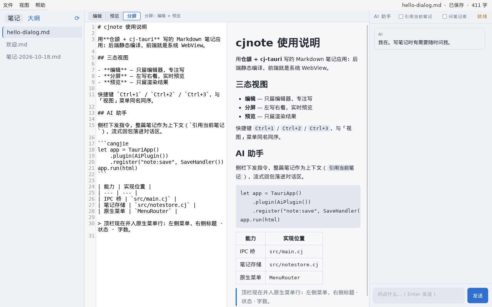
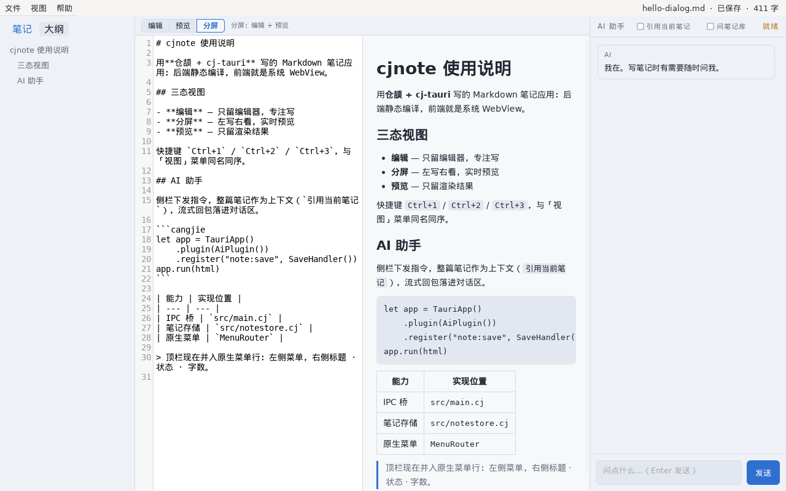
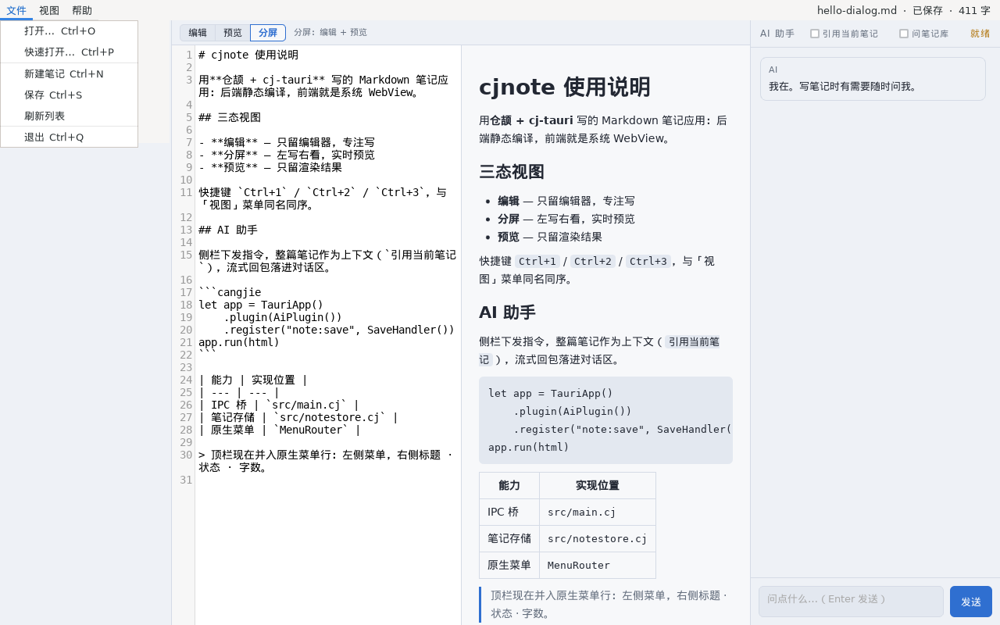

# cjnote — AI 原生 Markdown 笔记

用 [仓颉](https://cangjie-lang.cn/) + [cj-tauri](https://atomgit.com/qq8864/cj-tauri) 写的桌面笔记应用：
**后端静态编译，前端就是系统 WebView**（Linux WebKitGTK / Windows WebView2），不捆 Chromium、不带 Node。

三栏布局（笔记库 / 编辑区 / AI 助手），原生 GTK 菜单栏，顶栏的标题、保存状态与字数推进系统菜单行右侧的副标题。
本机实测：菜单、副标题、AI 流式对话、笔记增删改查整条链路都有 stderr 凭证。



*分屏模式：左侧编辑器（仓颉高亮 + 行号），右侧实时预览，最右是 AI 助手。系统菜单行右侧是「文件 · 状态 · 字数」副标题，页面自己的顶栏因此整条隐藏。*

## 功能

| 能力 | 说明 |
| --- | --- |
| **三态视图** | 编辑 / 分屏 / 预览，`Ctrl+1/2/3`；与原生「视图」菜单同名同序，切换后菜单勾选自动回写 |
| **原生菜单栏** | 文件 / 视图 / 帮助 三个顶层菜单；`Ctrl+O` 打开外部文件、`Ctrl+P` 快速打开、`Ctrl+N` 新建、`Ctrl+S` 保存、`Ctrl+Q` 退出 |
| **原生副标题** | 标题 · 已保存/未保存 · 字数，走 `setTitlebarSubtitle` 推到菜单行右侧；能力不可用（如 WebView2）时自动退回页面顶栏 |
| **大纲** | 侧栏第二个页签，抽 1~3 级标题（跳过围栏代码块里的 `#`），点一条跳一行 |
| **AI 助手** | 流式回包落进对话区；勾「引用当前笔记」把整篇注入上下文，勾「问笔记库」先全库检索再喂命中片段 |
| **选区动作** | 选中正文 → 重写 / 续写 / 翻译，结果先进 diff 确认条，接受才改文档、丢弃则原样 |
| **主题** | 跟随系统 / 浅色 / 深色，页面与原生菜单勾选双向同步，偏好落盘 |
| **外部文件草稿** | `Ctrl+O` 打开库外 `.md` 只进内存，首次 `Ctrl+S` 才落成库里的新笔记，**绝不静默改写磁盘原文件** |

<table>
<tr>
<td></td>
<td></td>
</tr>
<tr>
<td><em>大纲页签：标题点击跳行，围栏里的 <code>#</code> 不算标题</em></td>
<td><em>原生「视图」菜单：三态与界面主题都是勾选项，与页面状态同步</em></td>
</tr>
</table>



## 快捷键

| 按键 | 动作 |
| --- | --- |
| `Ctrl+1` / `Ctrl+2` / `Ctrl+3` | 编辑 / 分屏 / 预览 |
| `Ctrl+N` | 新建笔记 |
| `Ctrl+S` | 保存（外部草稿首次保存＝落库） |
| `Ctrl+O` | 打开磁盘上的 `.md`（原生文件对话框） |
| `Ctrl+P` | 页内快速打开库内笔记（`↑↓` 移动、`Enter` 打开、`Esc` 关闭） |
| `Ctrl+Q` | 退出 |

## 架构

```
ui/index.html            单页前端（HTML+CSS+JS，无构建步骤，改完重启即生效）
src/main.cj              应用装配：命令注册、菜单模型与 MenuRouter、主题/副标题回写
src/notestore.cj         笔记存储：列表 / 检索 / 打开 / 保存 / 新建 / 删除（名字净化，路径穿越在入口挡掉）
capabilities/default.json 能力清单：命令放行、事件声明、http 域名白名单
notes/                   笔记库（运行期数据，不入库）
```

命令一律经 `invoke` 走 IPC：

| 命令 | 作用 |
| --- | --- |
| `note:list` / `note:open` / `note:save` / `note:create` / `note:delete` | 笔记增删改查 |
| `note:search` | 全库关键词检索（标题 + 正文，返回命中片段） |
| `note:readExternal` | 读库外文件（外部草稿入口） |
| `theme:apply` / `titlebar:sync` | 主题同步到原生菜单勾选 / 副标题推送 |
| `dialog:open`、`store:*`、`http:*`、`log:write`、`clipboard:write` | 框架插件提供（对话框 / 偏好落盘 / AI 请求 / 日志 / 剪贴板） |

**AI 请求全部由仓颉侧直发**（页面零 `fetch`）：模型域名必须写进 `capabilities/default.json` 的
`scopes.http.allow` 才放行，越界即 `scope denied`。当前白名单：DeepSeek / OpenAI / 智谱 / 通义 / Moonshot /
Azure OpenAI，以及 `127.0.0.1`、`localhost`（本地 mock 自检用）。

Base URL 三种写法等价：裸域名、`.../v1`、`.../v1/chat/completions` 都会被归一化到完整端点，不用手填到最后一个斜杠。

## 运行

依赖与 cj-tauri 相同：仓颉 SDK 1.2.0 + stdx（同代），Linux 另需 `gcc pkg-config libwebkit2gtk-4.1-dev libgtk-3-dev`。

```bash
# 1) 编 C 桥（首次或框架有 C 改动时；产物在 cj-tauri/native/）
bash ../cj-tauri/native/build_linux.sh

# 2) 编本应用
cjpm build

# 3) 跑（stdx 动态库与桥都要进 LD_LIBRARY_PATH，否则启动即退、只留一行 so not found）
export LD_LIBRARY_PATH=$CANGJIE_HOME/runtime/lib/linux_x86_64_cjnative:$CANGJIE_STDX:../cj-tauri/native:$LD_LIBRARY_PATH
./target/release/bin/main
```

工作目录就是笔记库根：首次启动会在 `notes/` 下播种一篇 `欢迎.md`。AI 功能需要自备 API Key
（设置面板里填 Base URL / Key / 模型，落在 `store.json`，该文件与 `notes/` 都不入库）。

## 自检

无人值守跑一轮页面自检，结论经 `report` 回投 stderr：

```bash
CJNOTE_SELFCHECK=1 ./target/release/bin/main 2>&1 | grep SELFCHECK
# SELFCHECK DONE passed=31 failed=0
```

断言覆盖：列表与打开、保存与字数同步、三态切换与持久化、主题切换与勾选回写、外部草稿保存、
大纲抽取与跳行、原生副标题能力探测，以及（端点指向 `127.0.0.1`/`localhost` 时）AI 流式探针。
`CJNOTE_PROBE_AI=1` + `CJNOTE_MOCK_URL` 可指定 mock 端点，真实端点不会误跑。

## 平台状态

| 平台 | 状态 |
| --- | --- |
| Linux（WebKitGTK） | **已实机跑通**：菜单、副标题、AI 流式、笔记增删改查、自检 31 项全绿 |
| Windows（WebView2） | 代码路径与同名导出齐备（`--subsystem=windows`），副标题走能力位降级到页面顶栏；**未实机验证** |

## 相关文档

- 用仓颉写个桌面应用：cj-tauri 与 Markdown 笔记 —— [实战拆解](https://atomgit.com/qq8864/cj-tauri/blob/main/docs/用仓颉写个桌面应用-cj-tauri与Markdown笔记.md)
- cj-tauri 框架：[README](https://atomgit.com/qq8864/cj-tauri) · [使用文档](https://atomgit.com/qq8864/cj-tauri/blob/main/docs/使用文档.md)

## License

MIT
